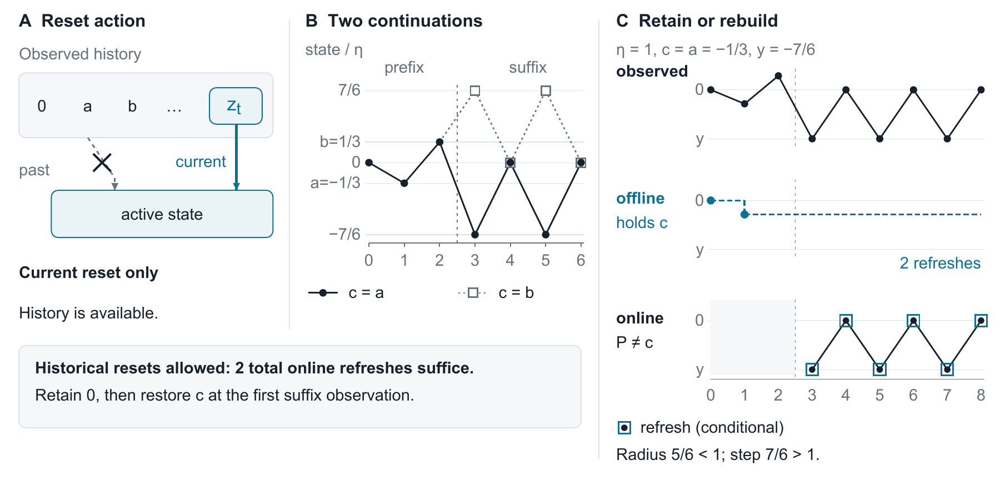

# The Cost of Missed States

### Online Tracking with Current-Observation Resets

Hiroyasu Usami

**An online tracker can remember a useful state and still be unable to restore it.**

Reference code and exact synthetic examples for the [companion manuscript](paper/main.pdf). A policy retains one state and may reset only to the current observation. Its full history is available; offline knows the future and obeys the same reset rule.

The manuscript has been submitted to IEEE Access.

[Main results](#main-results) · [Quickstart](#quickstart) · [Code and data](#code-and-data) · [Citation](#citation)



*Here $P$ is the state retained after the shared prefix, and $c$ is the center suited to the continuation.*

## Main results

$N$ counts refreshes, including initialization; $T$ is the observation count. $V_T$ is total path variation, and $J_\lambda$ is cumulative discrepancy plus a charge $\lambda$ per refresh.

| Objective | Result |
| --- | --- |
| **Hard-radius tracking** | On a known fixed five-point metric, for every $T\ge5$ and every feasible randomized causal policy, some fixed path has $\mathbb E[N]\ge(T+1)/2$. Offline uses exactly two refreshes with a strict radius margin. |
| **Penalized tracking** | A candidate prefix adapts Bienkowski and Schmid's randomized lower bound to the same current-reset actions for offline. The construction has a known horizon and $V_T<3\lambda$, using increasingly fine grids. |
| **Absolute cost under variation** | The anytime rule gives $J_\lambda\le\lambda+4\sqrt{\lambda T V_T}$ without knowing the horizon or final variation. For a known horizon, clipping also gives $J_\lambda\le\lambda T$. |

At fixed positive separation on a finite metric, penalized tracking admits a competitive policy. The manuscript also develops same-input output bounds for mixtures and squared-distance softmax.

## Quickstart

Python **3.10+**. The algorithms and checks use only the standard library.

Refreshes precede output; initialization is charged. Threshold tests use strict `>`; equality retains the state. The fixed rule knows final variation.

Run from the repository root:

```sh
python -m unittest discover -s tests
python verification/verify_refreshing.py
python benchmarks/run_benchmark.py
```

Full checks, boundary examples, and figure regeneration are in the [reproduction guide](docs/reproducibility.md).

## Code and data

| File | Contents |
| --- | --- |
| [refreshing.py](refreshing.py) | Exact rational policies, schedule costs, and the offline segmentation oracle |
| [benchmarks/protocol.json](benchmarks/protocol.json) | Three path families, three horizons, eight seeds, and four charges |
| [data/benchmark/cases.csv](data/benchmark/cases.csv) | All **288 synthetic path–charge cases**, with six policy records per case |
| [data/benchmark/summary.csv](data/benchmark/summary.csv) | Family-level median and maximum cost ratios |

The benchmark recomputes 72 seeded paths and all 1,728 policy records, writing results to `artifacts/benchmarks/`. These finite synthetic comparisons describe the specified path families; their observed ratios are not worst-case guarantees.

## Citation

```bibtex
@unpublished{usami2026missedstates,
  author = {Usami, Hiroyasu},
  title = {The Cost of Missed States: Online Tracking with Current-Observation Resets},
  year = {2026},
  note = {Unpublished manuscript}
}
```

Use [CITATION.cff](CITATION.cff) or [CITATIONS.bib](CITATIONS.bib) when citing the implementation.

Code and included synthetic data are available under the [MIT License](LICENSE). The manuscript PDF is copyright © 2026 Hiroyasu Usami and is outside the code license.
